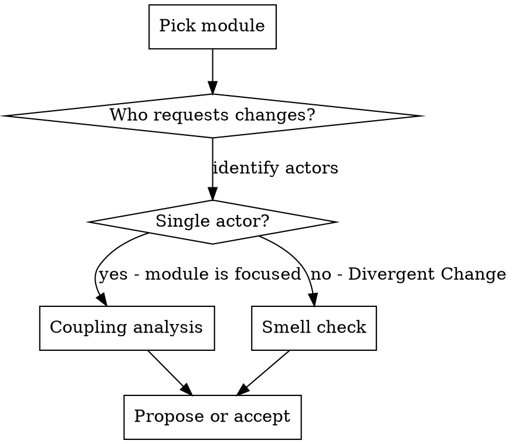

# SOLID TypeScript Module Audit

## Overview

Audit TS modules using SOLID principles (Uncle Bob), code smells (Fowler), and coupling analysis (Kent Beck). Every diagnostic question is change-relative: "coupled with respect to WHICH change?"

**Core formula (Kent Beck):** `cost(software) ~= coupling`

**Cardinal rule:** Don't over-decouple. Reducing coupling for one class of changes increases it for others. Find the sweet spot for changes that ACTUALLY happen.

## When to Use

- Before proposing structural changes to any `.ts` module
- When adding a statement or expression kind, a module (a built-in object such as `alis.http`), or a vendor
- When a bug fix requires touching 3+ files (Shotgun Surgery signal)
- When reviewing module boundaries after feature additions
- When `git log` shows the same files changing together repeatedly

## The Audit Protocol



### Step 1: Actor Analysis (SRP)

For each module, ask: **"WHO would request changes to this module?"**

| Actor | Meaning | Example |
|-------|---------|---------|
| "Anyone adding a statement or expression kind" | Grammar actor | `grammar/execute.ts`, `grammar/evaluate.ts` |
| "Anyone changing how a vendor's object is found or subscribed" | Vendor actor | `objects/vendor-driver.ts` |
| "Anyone changing how a value converts for an operator" | Data transformation actor | `grammar/shape.ts`, `grammar/operators.ts` |
| "Anyone changing how validation messages show" | UI actor | `modules/form/display.ts` |

2+ actors = Divergent Change. One actor through multiple operations (e.g., `grammar/shape.ts` checks a shape and converts to it: `shaped`, `asNumber`, `asDate`) is cohesive.

### Step 2: Change-Relative Coupling Analysis

| Change scenario | Files touched | Verdict |
|-----------------|---------------|---------|
| Add a statement or expression kind | ? | >2 runtime files (beyond the regenerated `types/plan.ts`) = Shotgun Surgery |
| Add a component | ? | >0 = the plan is missing information (component tripwire) |
| Add a vendor | ? | >0 = coupling leak: a vendor is plan data `objects/vendor-driver.ts` follows |
| Add a shape or operator | ? | >2 = Shotgun Surgery |
| Add a validation rule | ? | >2 = Shotgun Surgery |
| Make a statement awaited | ? | >1 = sync/async boundary cascade |
| Fix a bug in conditions (the `if` statement) | ? | >1 = cascade risk |

**How to measure:** `git log --name-only` on related commits. Files that change together ARE coupled. Only audit coupling for changes that ACTUALLY happen or are LIKELY to happen.

### Step 3: Smell Detection

| Question | If yes | Smell |
|----------|--------|-------|
| Does this module change for 2+ unrelated reasons? | Split Phase / Extract Module | Divergent Change |
| Does adding one feature require editing 3+ files? | Move Function / consolidate | Shotgun Surgery |
| Does this function import more than it uses locally? | Move to the module it envies | Feature Envy |
| Do two modules import each other's internals? | Hide Delegate / third module | Insider Trading |
| Does this switch/if-chain appear in 2+ files? | Dispatch map | Repeated Switches |
| Do 3+ params always travel together? | Introduce Parameter Object | Data Clumps |
| Does this module have mutable state written by 2+ functions? | Encapsulate Variable | Global Data |

### Step 4: Dependency Direction (DIP)

Dependencies must point toward stability. The layers of `Alis.Reactive.Assets/runtime/`, as the
import-direction test in `runtime/__tests__/architecture.test.ts` enforces them:

```
Most stable (pure, no deps)     ←  Everything depends inward
├── shared/       assert-never, javascript-string (zero deps)
├── types/        the generated contract, plan.ts (zero deps)
├── diagnostics/  trace (shared only)
├── grammar/      shape, operators, paths, evaluate, execute: the interpreter (grammar, types, shared, diagnostics)
├── objects/      vendor-driver, owner, world, modules: locating objects (+ grammar)
├── plans/        discover, start, mount-events: starting an owner (+ objects)
├── modules/      document, http, model, form, slot: the built-in objects (+ plans)
├── realtime/     stream, hub, retry-indicator (objects, types, shared, diagnostics)
├── root.ts       registers the modules and boots the page (entry point; nothing imports it)
Least stable (side effects, DOM)
```

The framework's component code (`Alis.Reactive.Assets/components/`) sits beside the runtime, not on
this ladder: neither side imports the other.

**Violation signal:** A pure module importing from a side-effect module. A stable module importing from a volatile module.

### Step 5: Extension Check (OCP + LSP)

For each discriminated union in the generated contract (`runtime/types/plan.ts`) — e.g., `Statement`, `Expr`, `ObjectLocator`, `Operator`, `Shape`:

1. **Where is the switch?** One switch in one place = acceptable (TanStack pattern). Same switch in 2+ files = violation. **Nuance:** Repeated switches on the SAME discriminated union but with DIFFERENT target types (e.g., event object vs DOM element) may be acceptable duplication. Weigh the cost of introducing a target abstraction against the cost of the duplication before refactoring.
2. **Is the resolved root substitutable?** After `resolveRoot()`, does ANY downstream code check vendor? If yes = LSP violation.
3. **Can you add a new kind by writing NEW code only?** If modifying existing code = OCP violation.

**Acceptable OCP cost:** Adding a new reaction kind requires updating the C# plan domain, regenerating `types/plan.ts`, one runtime switch (e.g., the statement switch in `runtime/grammar/execute.ts`) + tests. That's the minimum. If it requires more, investigate.

### Step 6: Export Surface Check (ISP)

For each module, count: exports used by other modules vs total exports.

```
Module: grammar/evaluate.ts
  Exports: World, Scope, childScope, evaluate, modeOf, labelOf, evaluateStatement, isPromise (8)
  Used by grammar/execute.ts: childScope, evaluate, evaluateStatement, isPromise, labelOf, modeOf, Scope (7/8)
  Used by modules/model.ts and modules/form/form.ts: evaluate (1/8)
  Used by plans/start.ts: isPromise (1/8)
  Used by objects/world.ts: World (1/8)
```

**If <50% of exports are used by any single consumer,** the module may be too broad. Consider splitting.

**What a violation looks like:** an export with zero importers outside its own module (and its tests) exposes internals no consumer needs; make it module-private.

**Exception:** Utility modules (`shared/`, `grammar/operators.ts`) can have broad exports — they serve many consumers by design.

## Refactoring Decision Framework

Before proposing any refactoring, answer Kent Beck's four questions:

1. **Cost** — Will this make future changes cheaper?
2. **Revenue** — Does this unblock a feature someone is waiting for?
3. **Coupling** — Will this reduce files touched per change?
4. **Cohesion** — Will this concentrate changes into fewer modules?

If the answer to all four is "no" or "marginally" — **don't refactor**. The coupling of over-decoupling isn't worth it.

**"Make no sudden moves. Move one element at a time."** — Kent Beck

## Pattern Decisions (Pre-Validated)

### Switch vs Map for Dispatch
- **Switch wins at 4-8 stable kinds** — free TS narrowing, exhaustiveness via `assertNever`
- **Map wins at 10+ extensible kinds** — plugin architectures, runtime handler registration
- V8 treats small string switches as sequential comparisons — optimal at 4 cases
- TypeScript compiler itself uses giant switches for SyntaxKind — authoritative

### `assertNever` Exhaustiveness — ALWAYS ADD
```typescript
function assertNever(value: never, context: string): never {
  throw new Error(`Unhandled ${context}: ${(value as any).kind ?? value}`);
}
// In every switch on discriminated unions:
default: assertNever(cmd, "command kind");
```
Zero cost. Compile-time enforcement. Strict improvement over silent miss.

### Sync Until the First Await
- `grammar/execute.ts` runs a block synchronously until its first awaited statement and continues when that settles; a block with no awaited statement never returns a promise
- This is load-bearing, not an optimization: a vendor reads a payload's `cancel` in the same turn the handler runs, so a handler that always returned a promise would miss it
- Only `do` and `let` with `await` wait; making any other statement async is a sync/async boundary change

### Chaining vs Function Dispatch
- **C# DSL chaining** — correct for configuration (Fowler endorses for value objects)
- **TS runtime function dispatch** — correct for execution (CQS, tree-shakeable, side effects)

### Nested Ifs
- **Guard clauses** (early returns) flatten nested conditionals
- **Decompose Conditional** — extract complex boolean into named functions
- Recursive evaluation is correct for tree data structures (guards are trees)

### Parameters
- 1-2 ideal, 3 acceptable, 4+ borderline (Uncle Bob Clean Code Ch. 3)
- **Zero boolean flags** in our codebase — this is a strength
- Introduce Parameter Object only when same group travels across multiple call sites

### Types
- The runtime's types come from `types/plan.ts`, generated from the C# grammar; never hand-written beside it
- Types map 1:1 to the plan grammar's productions (statements, expressions, object locators, shapes, operators)
- A runtime-only type earns its place by naming execution state (a scope, an owner), never by re-describing plan JSON

## Architecture Constraints (Non-Negotiable)

1. **Runtime is dumb executor** — NEVER invents behavior, plan carries ALL info
2. **ID-aware** — always use element IDs, never wide selectors
3. **No fallbacks** — fail fast, throw on missing data, no silent defaults
4. **No wide selectors** — forces thinking deeply about correct behavior
5. **No caching** — premature for now, will add when needed
6. **No inline JS in views** — `root.ts` boots and `plans/discover.ts` finds the plan scripts

## Audit Discipline — NEVER Rubber-Stamp

**"PASS" is earned, not given.** Every module must be challenged:

1. **Trace the actual runtime behavior** — don't just read the code structure. Ask: "what happens when a Syncfusion ComboBox changes? Does `objects/vendor-driver.ts` subscribe where the plan's vendor data says? Does the handler's payload read the path the plan names?" If you can't answer from the code, it's not audited.
2. **Challenge every DOM interaction** — is this using an ID (good) or scanning (bad)? Is this vendor-blind, or does it depend on one vendor's DOM structure?
3. **Test the extension story** — don't just say "open for extension." Actually walk through adding a new component/vendor/rule and count the files that change.
4. **Question silent skips** — every `if (!x) return` is a potential swallowed bug. Is it intentional or lazy? Does the caller know this silently no-ops?
5. **Verify against real component behavior** — a Syncfusion component raises events on its own object, a native input on the DOM element; the plan's vendor data says which. Does the module follow that data for both, or assume one?

**If you find yourself writing "PASS" without finding at least one question worth investigating, you're not auditing — you're skimming.**

## Red Flags — STOP and Investigate

- Module imports from 5+ other modules (possible god module). Exception: an entry point (`root.ts`) that registers every module MUST import them. Check whether each import is one registration — if so, it is coordination, not a god module.
- Circular imports between any two modules
- A vendor named anywhere in `runtime/` (vendor knowledge lives in the plan's vendor data and in `components/`)
- Module-level `let` mutated by 3+ functions
- Same `switch(x.kind)` in 2+ files
- Function with 6+ parameters or any boolean flag parameter
- Wide selectors (`querySelector("input")`, `querySelectorAll("div")`)
- Fallback defaults for missing data
- Caching or memoization (premature — not yet needed)
- Non-null assertion (`!`) hiding potential null paths — the `!` bypasses TypeScript's null check. Verify the runtime path handles null before accepting `!`.
- Test file exists but tests don't cover the change scenario

**Test coverage note:** `runtime/__tests__/architecture.test.ts` checks four of these mechanically: wide DOM queries outside the allowlisted boundaries, Syncfusion knowledge in the runtime, imports against the layer direction (and nothing importing `root.ts`), and imports between the runtime and `components/`. Every other red flag needs a reader.

## What This Skill Does NOT Cover

- Class hierarchies and inheritance (we use modules + functions)
- Generic OOP patterns (Strategy, Observer, etc. — use when naturally emerging, don't force)
- Performance optimization (separate concern)
- Trace module quality (explicitly low priority)

## Sources

- Robert C. Martin — Clean Architecture (2017), Clean Code Ch. 3 (params), Functional Design (2023), blog.cleancoder.com
- Martin Fowler — Refactoring 2nd Ed (2018), code smells catalog, FluentInterface bliki, FlagArgument bliki
- Kent Beck — Tidy First? (2023), Chapters 29-33 on coupling/decoupling
- TanStack — Query, Router, Table source code patterns (real-world validation)
- V8 blog — async/await optimization, switch internals
- Bob Nystrom — "What Color is Your Function?" (function coloring problem)
- GraphQL-JS — PromiseOrValue pattern for sync/async unification
